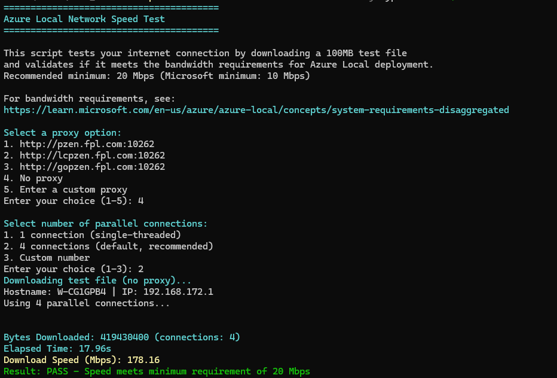

# New-VMSwitch.ps1
This will prompt for input and create a single VM Switch with a single NIC for a 2 node Azure Local Cluster

![New-VMSwitch screenshot][def]

```powershell
$uri = "https://raw.githubusercontent.com/TideWithBleach/Tools/main/PowerShell/New-VMSwitch.ps1"
$out = Join-Path $env:TEMP "New-VMSwitch.ps1"
Invoke-WebRequest -Uri $uri -OutFile $out -UseBasicParsing
powershell.exe -NoProfile -ExecutionPolicy Bypass -File $out

```
# speedtest.ps1
This will prompt for input and download a 100MB file to test your internet speed through a proxy or without a proxy. The test file is served from a CDN that automatically routes to the nearest edge location for accurate results. Allows selection of parallel connections (1-16) for multi-threaded download testing.

For Azure Local bandwidth requirements, see: [Microsoft Learn - System Requirements](https://learn.microsoft.com/en-us/azure/azure-local/concepts/system-requirements-disaggregated)



```powershell
$uri = "https://raw.githubusercontent.com/TideWithBleach/Tools/main/PowerShell/speedtest.ps1"
$out = Join-Path $env:TEMP "speedtest.ps1"
#$Proxy = "http://lcpzen.fpl.com:10262" # Optional - uncomment to use proxy
Invoke-WebRequest -Uri $uri -OutFile $out -UseBasicParsing -Proxy $Proxy
powershell.exe -NoProfile -ExecutionPolicy Bypass -File $out

```


[def]: New-VMSwitch.png